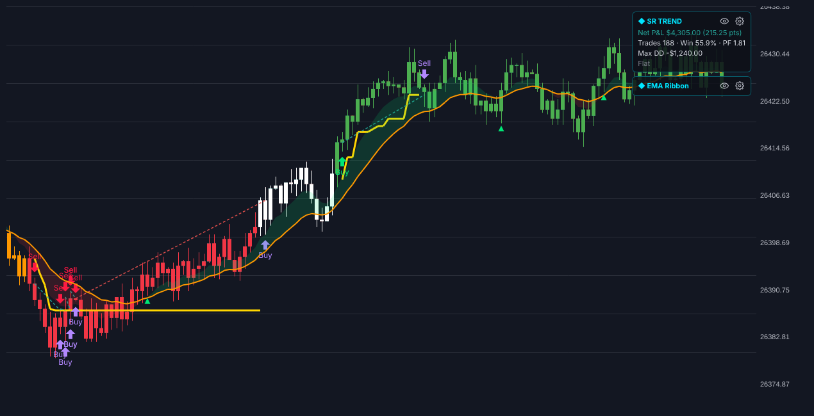
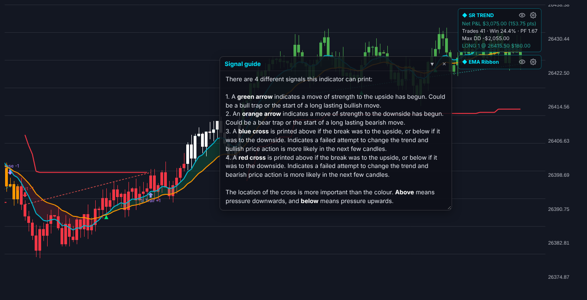
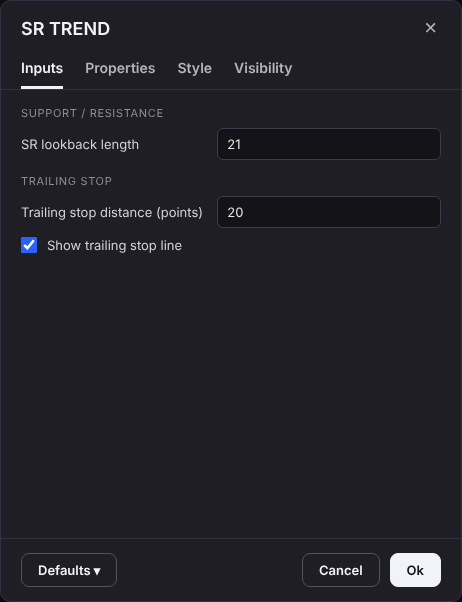
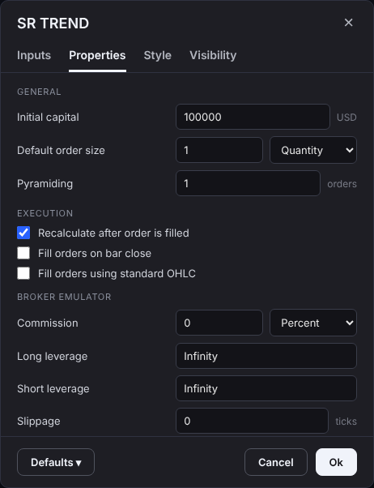
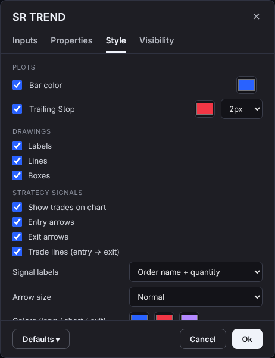

# PineTS Overlay for Tradara

**Run your Pine Script® indicators and strategies directly on the Tradara Terminal chart.**

PineTS Overlay is a Chrome extension that draws TradingView-style indicators and backtested strategy signals on top of the
chart at [terminal.tradara.com](https://terminal.tradara.com). Tradara doesn't support strategies yet. This extension fills
that gap: paste in your Pine Script v5/v6 code and it calculates on the same bars your Tradara chart is showing, live, with
entry/exit arrows, trade lines and a performance panel. It's powered by LuxAlgo's open-source
[PineTS](https://github.com/LuxAlgo/PineTS) engine.


<sub>Screenshot from a test chart with sample data.</sub>

---

## Features

- **Pine Script v5 and v6**: indicators and strategies, pasted in or imported from `.pine` files
- **Live**: recalculates on new bars and price ticks, and stays aligned as you pan and zoom
- **Strategy backtesting on the chart**:
  - entry and exit arrows, plus dashed lines from entry to exit (green for winners, red for losers)
  - an info panel with net P&L ($ and points), number of trades, win rate, profit factor, max drawdown and current position
  - real futures contract specs (tick size and $ per point for NQ, MNQ, ES, MES, YM, RTY, GC, CL and more), so tick-based stops and targets, and dollar P&L, are correct
- **TradingView-style settings for every script**: Inputs, Properties, Style and Visibility tabs
- **Max trades per day**: caps how many new trades a strategy can take each trading day
- **Drawing support**:
  - `plot()`: line, step, area, histogram, columns, circles, cross
  - per-bar colors, `hline`, `fill`, `bgcolor`, `barcolor`
  - `plotshape`, `plotchar`
  - `label.new`, `line.new`, `box.new`, `linefill`, `polyline`
- **`overlay=false` scripts** (RSI, MACD…) draw in a strip at the bottom of the chart
- **Higher-timeframe `request.security`** on the same symbol, built from the chart's own bars
- **Chart notes**: put your own text boxes on the chart (signal guides, trading rules, checklists) that you can drag, resize and collapse
- **Self-healing**: if the page interferes with the extension, it restarts itself automatically
- **Private**: makes no network requests. Your scripts and settings stay in your browser.

---

## Installation

The extension isn't on the Chrome Web Store, so you load it in developer mode (it takes a minute).

1. **Download** this repository: click **Code → Download ZIP** and unzip it somewhere permanent, such as your Documents
   folder. Chrome loads the extension from that folder, so don't delete it.
2. Open Chrome and go to `chrome://extensions`.
3. Turn on **Developer mode** (top-right switch).
4. Click **Load unpacked** and select the unzipped folder (the one containing `manifest.json`).
5. Click the puzzle-piece icon in Chrome's toolbar and **pin** "PineTS Overlay for Tradara".
6. Open or refresh [terminal.tradara.com](https://terminal.tradara.com).

Works in Chrome, Edge, Brave and other Chromium browsers.

### Updating

Download the new version, replace the files in the same folder, then click **reload ↻** on the extension's card in
`chrome://extensions` and refresh Tradara. Your saved scripts and settings are kept.

---

## Quick start

1. Click the extension icon, then **Manage scripts & settings**.
2. Click **+ New strategy** to load an example, or paste your own Pine Script into the editor.
   You can also use **Import .pine / .txt file**.
3. Make sure **Show on chart** is ticked and click **Save** (or press Ctrl/Cmd + S).
4. Switch to your Tradara tab. The script appears on the chart within a second or two, with its name in the legend at the
   top right.

An example strategy is included in [`examples/sr_trend_v6.pine`](examples/sr_trend_v6.pine).

---

## How to use it

### The popup (extension icon)
- **Master switch** (top right): turns the whole overlay on or off.
- **One switch per script**: turns that script on or off.
- Each script shows its status: `ok · 120 ms`, `waiting for chart…` or `error` (hover to see the error message).
- **Manage scripts & settings** opens the full manager.

### The manager page
- A list of all your scripts on the left, with a code editor on the right.
- **+ New strategy / + New indicator / + New pane indicator** start from a template.
- **Import** loads a `.pine` or `.txt` file.
- **⚙ Settings** opens the script's settings dialog (see below).
- The status bar under the editor shows whether the script ran, how long it took, and any error with its line number.
- **Settings** at the bottom holds the global options (see [Global settings](#global-settings)).

### The legend on the chart
Each active script appears in a box at the top right of the Tradara chart:
- **Click the name or ⚙** to open its settings.
- **👁** hides or shows the script without turning it off.
- Strategies show net P&L, trades, win rate, profit factor, max drawdown and current position.
- Errors appear here in red, so you don't have to open the manager to see them.

### Chart notes
Text boxes that sit on your chart, useful for memorizing what an indicator's signals mean or keeping your trading rules in
view. A **Signal guide** example is included.
- In the manager, under **Chart notes**, click **+ New note**, give it a title and type or paste your text. It saves as you
  type.
- Wrap words in `**double asterisks**` to make them **bold**.
- Options: text size, background opacity, title color, **Reset position**.
- On the chart: **drag the title bar** to move the box, **drag the bottom-right corner** to resize it, **▾** collapses it
  to just the title, and **×** hides it. Turn it back on from the extension popup, which has a switch for each note.
- Position and size are remembered, and the box stays in the same spot relative to the chart when you resize the window.



---

## Script settings (TradingView-style)

Open them from the ⚙ in the chart legend or from the manager. Changes apply to the chart immediately. **Cancel** undoes
them, **Ok** keeps them, and **Defaults** resets the current tab or everything.

| Inputs | Properties | Style |
|---|---|---|
|  |  |  |

### Inputs
Built automatically from your script's `input.*()` calls, grouped the same way as in your code: numbers, true/false
switches, dropdowns, price sources, colors, timeframes, text and dates. Change a value and the script re-runs.

### Properties (strategies)
| Setting | What it does |
|---|---|
| Initial capital | Starting account size for the backtest |
| Default order size | Quantity (contracts), cash amount, or % of equity |
| Pyramiding | How many entries are allowed in the same direction |
| Recalculate after order is filled | Same as `calc_on_order_fills` |
| Fill orders on bar close / using standard OHLC | Fill model options |
| Commission | Percent, USD per contract, or USD per order |
| Long / Short leverage | `Infinity` = no margin requirement (the usual setting for futures) |
| Slippage | Ticks of slippage on fills |
| Verify price for limit orders | Ticks price must trade through for a limit fill |
| Close entries rule | FIFO or ANY |
| **Max trades per day** | Caps new trades per trading day. `0` = no limit. When the limit is reached, new entries are skipped until the next day. Exits and stops still work. |
| Trading day starts | Futures session (6:00 PM ET) or midnight ET |

> **Tip for futures:** if a strategy shows **0 trades**, set both leverage fields to `Infinity`.
> Pine v6 requires 100% margin by default, so one NQ contract (about $500K notional) is bigger than a $100K account.

### Style
- **Plots**: show or hide each plot, change its color and line width (including bar color, background and fills).
- **Drawings**: turn labels, lines and boxes on or off.
- **Strategy signals**:
  - show or hide trades, entry arrows, exit arrows and entry→exit lines
  - signal label text: *order name + quantity*, *order name*, *quantity*, *Buy / Sell*, or *none*
  - arrow size (small, normal, large) and colors for long, short and exit
- **Info panel**: show or hide this script's performance stats.

### Visibility
Choose which chart timeframes the script appears on (seconds, minutes, hours, days, weeks, months, each with a range).
For example, show a scalping strategy only on 1–5 minute charts.

---

## Global settings
In the manager, under **Settings**:

| Setting | Default | Meaning |
|---|---|---|
| Overlay enabled | On | Master on/off |
| Show strategy trade markers | On | Global switch for all trade arrows and lines |
| Show info panel | On | Performance stats in the legend |
| Strategies use closed bars only | On | Strategies only act on completed bars, so signals don't appear and disappear while a bar is still forming |
| Max bars | 5000 | How many of the chart's most recent bars are used. More bars = longer backtest, slower runs. Scroll left in Tradara to load more history. |
| Point value $ | 0 (auto) | Override the $ per point if your symbol isn't recognised |

---

## Things to know

- **Display only.** The extension never places, changes or cancels orders on Tradara.
- **Backtests are hypothetical.** Results come from the bars loaded on the chart and PineTS's broker emulator, so they
  won't match TradingView exactly. This is not financial advice.
- **Pine v4 and older isn't supported.** Convert scripts to v5 or v6 first (TradingView's Pine Editor has a converter).
- **TradaraScript isn't Pine Script.** Scripts written in Tradara's own language won't run here. Use the original Pine
  version.
- **`request.security`** works for the same symbol at the chart timeframe or higher. Other symbols and lower timeframes
  return `na`.
- **Not supported yet:** `table.*` drawings.
- **Max trades per day** counts entries made with `strategy.entry()`. Entries made with `strategy.order()` aren't counted.
- **If you add or reorder `input.*()` lines in your code**, use **Defaults → Reset this tab** on the Inputs tab, because
  saved input values are matched by position.
- **Tradara updates can break it.** The extension reads Tradara's chart internally, so a Tradara update could break the
  overlay until the extension is updated.

---

## Troubleshooting

| Problem | Fix |
|---|---|
| Nothing appears on the chart | Check the master switch and the script's switch in the popup, then refresh the Tradara tab. |
| Legend says **Error: …** | Fix the line mentioned in the message. Make sure line 1 is `//@version=5` or `//@version=6` (two slashes). |
| "This is TradaraScript…" | Paste the original Pine Script instead of Tradara's converted version. |
| Strategy shows **0 trades** | Set Long/Short leverage to `Infinity` in Properties, or lower the order size. |
| Stuck on **Calculating…** | Wait a few seconds; the engine restarts itself. If it stays stuck, refresh Tradara. For more detail, open DevTools (F12) → Console and look for `[PineTS Overlay]` messages. |
| Overlay doesn't line up with candles | Refresh the Tradara tab. If it persists, Tradara may have changed its chart. Please open an issue. |

---

## How it works

```
Tradara chart ──bars──▶ page.js ──▶ content.js ──▶ sandbox.html (PineTS engine)
      ▲                                                  │
      └──────── overlay canvas + legend ◀── results ─────┘
```

- **`page.js`** runs inside the Tradara page. It finds Tradara's chart, reads its bars, and draws results on a
  transparent canvas using the chart's own price/time-to-pixel conversion. That's why the drawings stay aligned while you
  pan and zoom. It also draws the clickable legend.
- **`content.js`** stores your scripts (Chrome storage), passes data between the page and the engine, and keeps the
  engine running.
- **`sandbox.html` / `sandbox.js`** run PineTS inside a sandboxed extension page, because PineTS compiles code at runtime,
  which normal extension pages don't allow. This is also where your inputs, properties and the max-trades-per-day limit
  are applied.
- **`settings-ui.js`** is the settings dialog. **`popup.*`** and **`manager.*`** are the extension's own pages.

### Project structure
```
manifest.json          Extension manifest (Manifest V3)
page.js                Chart detection, rendering, legend
content.js             Storage, messaging, engine watchdog
sandbox.html/.js       PineTS runner
settings-ui.js         Inputs / Properties / Style / Visibility dialog
notes.js               Chart notes editor (manager page)
popup.html/.js         Toolbar popup
manager.html/.js       Script manager & editor
store.js               Shared storage helpers & templates
vendor/                PineTS browser build (AGPL-3.0)
examples/              Example Pine scripts
icons/, docs/          Icons and screenshots
```

---

## Privacy

- No analytics, tracking or network requests.
- Scripts and settings are saved in your browser's extension storage.
- The extension only runs on `terminal.tradara.com`. It reads the chart's price bars from the page you already have open.

---

## Credits & license

- Pine Script engine: [PineTS](https://github.com/LuxAlgo/PineTS) by LuxAlgo, licensed AGPL-3.0.
- This extension is also licensed under **AGPL-3.0** (see [LICENSE](LICENSE)). You can use, modify and share it. If you
  distribute a modified version, you must share its source code under the same license.
- Not affiliated with Tradara, TradingView or LuxAlgo. Pine Script® is a trademark of TradingView, Inc.
